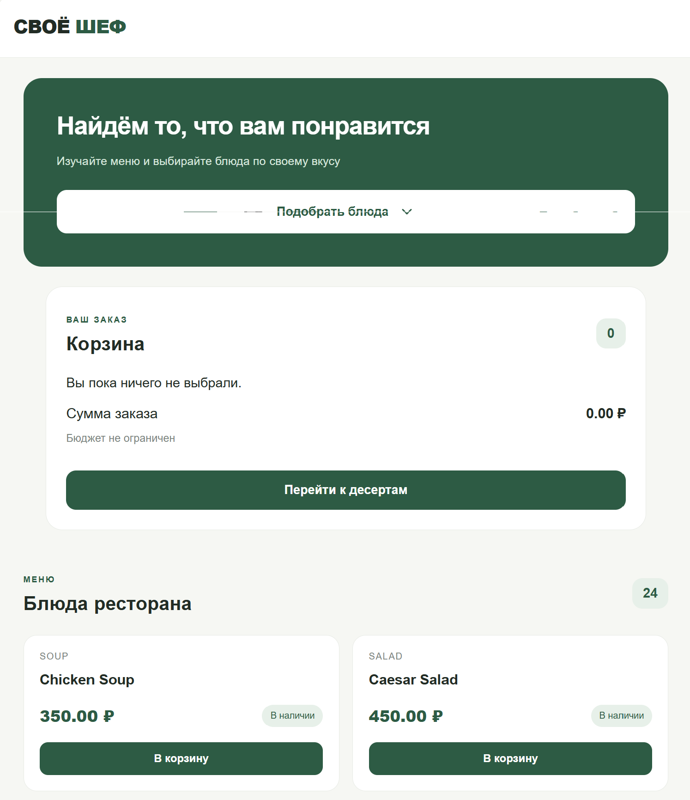
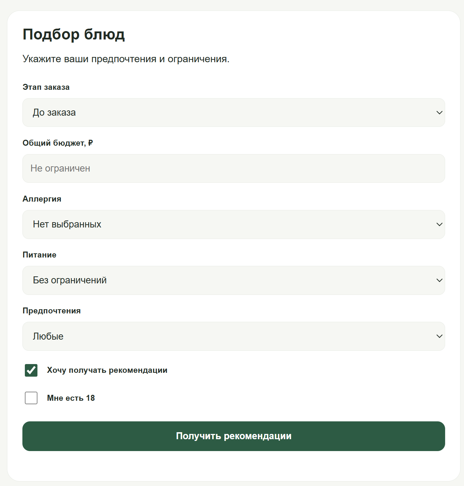
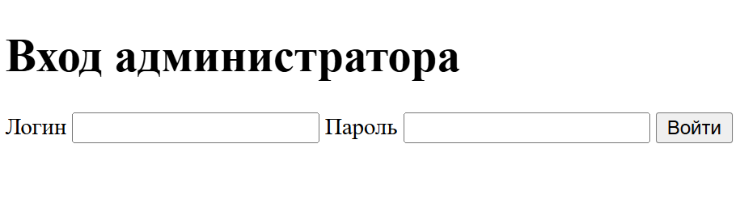
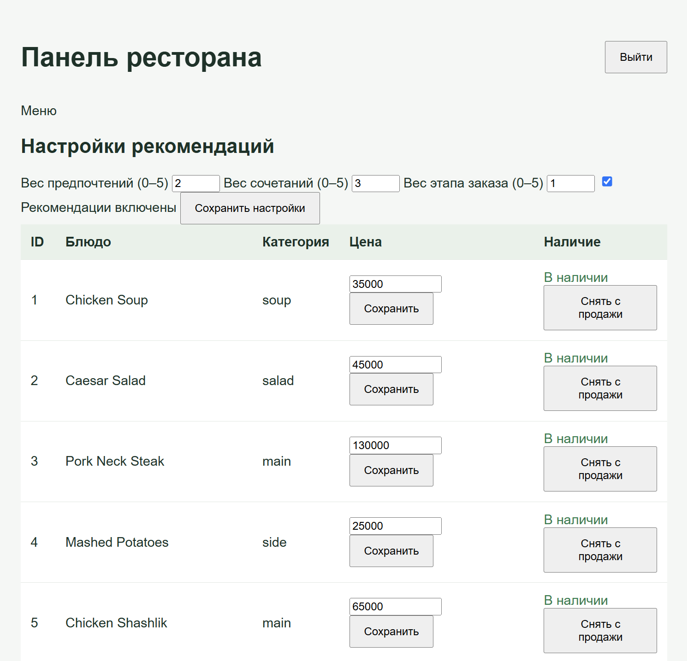

# Своё Шеф - рекомендации блюд для ресторана

Веб-приложение для подбора блюд в ресторане с учётом вкусовых предпочтений, бюджета, аллергий и пищевых ограничений. Проект приурочен к конкурсному кейсу от РСХБ.

## Возможности

- **Три сценария:** до заказа, после выбора основного блюда и перед десертом.
- **Персональный подбор:** до трёх рекомендаций с учётом предпочтений, бюджета, аллергий и пищевых ограничений.
- **Корзина:** добавление блюд, подсчёт суммы и пересчёт рекомендаций.
- **Управление рестораном:** изменение цен, наличия, весов ранжирования и включение или отключение рекомендаций.

## Технологии

**Backend:** Python, Flask, SQLite
**Frontend:** HTML, CSS, JavaScript, Jinja2
**Тестирование:** pytest

## Локальный запуск

Инструкция для `Windows`. Команды выполняются из корня проекта в терминале PowerShell. Нужен установленный Python.

**1. Создать окружение и установить зависимости**

```powershell
py -m venv .venv
.\.venv\Scripts\python.exe -m pip install -r requirements.txt
```

**2. Подготовить демонстрационную базу данных**

Только при первом запуске в новой копии проекта, в которой ещё нет файла `instance/rshb_chef.db`:

```powershell
.\.venv\Scripts\python.exe -c "from app.db import init_db; init_db()"
.\.venv\Scripts\python.exe seed_demo.py
```


**3. Настройка окружения**

Создайте файл `.env` в корне проекта:

```dotenv
RSHB_SECRET_KEY=ваш_случайный_секретный_ключ
RSHB_ADMIN_USER=admin
RSHB_ADMIN_PASSWORD_HASH=ваш_хеш_пароля
```

Сгенерировать ключ сессии:

```powershell
.\.venv\Scripts\python.exe -c "import secrets; print(secrets.token_urlsafe(32))"
```

Сгенерировать хеш пароля администратора:

```powershell
.\.venv\Scripts\python.exe -c "from getpass import getpass; from werkzeug.security import generate_password_hash; print(generate_password_hash(getpass('Пароль: ')))"
```

Полученные значения вставьте в `.env`.

**4. Запуск приложения**

```powershell
.\.venv\Scripts\python.exe -m flask --app app:create_app run
```

**Гостевой интерфейс: http://127.0.0.1:5000/menu**

**Административная панель: http://127.0.0.1:5000/admin/login**


## Тестирование

```powershell
.\.venv\Scripts\python.exe -m pytest -q
```


## Скриншоты

### Интерфейс для гостя



### Рекомендации для гостя



### Вход в панель администратора



### Панель администратора



---
